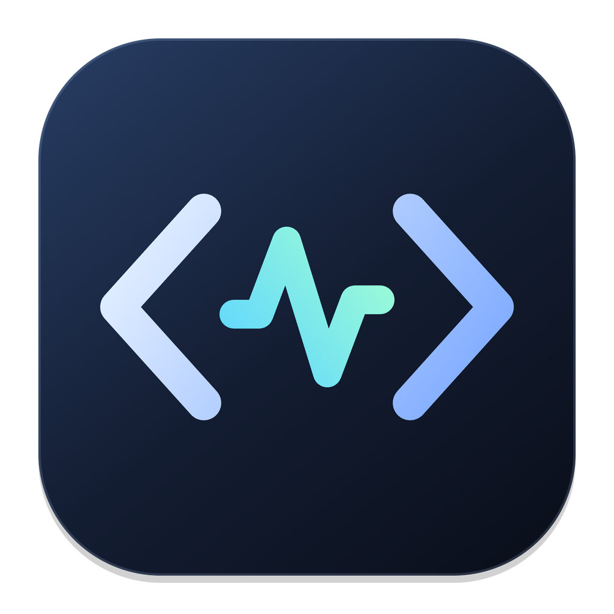

<p align="center">
  
</p>

<h1 align="center">Mac Vibe Coder</h1>

<p align="center">
  Claude Code · Codex CLI 를 한 화면에서 쓰는 macOS 전용 바이브코딩 앱.<br/>
  IDE 없이, 구독 로그인된 로컬 CLI 그대로, 내 입맛대로 만든 UI로.
</p>

<p align="center">
  <code>macOS 14+</code> · <code>Node 20+</code> · <code>Electron</code> · <code>React</code> · <code>Hono</code> · 개인용 · API 키 없음
</p>

---

## 왜 만들었나

바이브코딩을 하다 보면 코드를 직접 보는 시간보다 에이전트와 대화하는 시간이 길다. 그런데 Claude Code 는 이 터미널, Codex 는 저 터미널, 결과물 확인은 Finder 와 브라우저… 전부 흩어져 있다.
Mac Vibe Coder 는 그걸 한 창에 모은다. 폴더를 고르면 그 폴더를 루트로 에이전트 세션이 열리고, 옆에서 파일을 보고, 터미널을 띄우고, 커밋까지 한다.

- **API 키를 쓰지 않는다.** 이미 설치·로그인된 `claude`(claude.ai 구독) 와 `codex`(ChatGPT) 바이너리를 그대로 쓴다. CLI 로 쓰는 것과 요금·한도가 똑같다.
- **코드는 안 숨긴다.** 전부 TypeScript. 마음에 안 드는 UI 는 고쳐 쓰면 된다.
- **자동 업데이트.** GitHub `main` 이 앞서면 헤더에 배지가 뜨고, 클릭 한 번이면 pull · build · 재시작.

## 주요 기능

| 영역 | 내용 |
|------|------|
| **에이전트 채팅** | Claude Code / Codex 선택, 토큰 스트리밍, 도구 실행 카드, 승인 카드(허용 · 항상 허용 · 거부+사유), 질문 카드, 권한 모드 · 모델 즉시 전환, 중단, 실행 중 큐잉/steer |
| **세션** | 프로젝트별 멀티 세션 탭, 이전 세션 이어하기(두 에이전트 모두), 이름 변경 · 삭제, 전체 프로젝트 최근 세션 목록 |
| **입력** | `/` 슬래시 커맨드 · 스킬 자동완성, `@` 파일 멘션(프로젝트 루트 기준 퍼지 검색 + 자동 첨부), Finder 드롭 · 파일 트리 드롭 · 클립보드 이미지 붙여넣기 |
| **파일** | 탐색기(싱글클릭 선택 · 더블클릭 열기), ⌘C/⌘X/⌘V 복사·이동, 복제, 이름 변경, 새 폴더, 휴지통(Finder 경유 · 복원 가능), 우클릭 메뉴, 퀵오픈 ⌘P |
| **미리보기** | Markdown(상대 경로 이미지 · 로컬 링크 해석 · 코드 하이라이트), 이미지, 영상(탐색 가능), 오디오, PDF, 텍스트 |
| **터미널** | xterm.js + node-pty 로그인 셸, `claude` / `codex` TUI 원클릭, Terminal.app · Finder · VS Code · Cursor 로 열기 |
| **Git** | 브랜치 전환 · 생성, fetch / pull / push, 상태 · diff · 스테이지 · 커밋 · Commit & Push, 최근 로그 |
| **즐겨찾기** | 폴더 즐겨찾기, 그룹(폴더)으로 묶기 · 접기, 드래그로 이동, 최근 폴더, 프로젝트 아이콘 자동 감지(public/favicon, Next app/icon, Godot project.godot, Tauri, Xcode AppIcon, .icns 등) |
| **헤더** | Claude 5시간 · 주간 · 모델별, Codex 5시간 · 주간 남은 % 바, 업데이트 배지 |
| **운영** | CLI 감지 + 설치/업데이트 버튼(공식 스크립트 · Homebrew · npm), 로그인 시 자동 실행, 창이 안 보일 때 완료/승인/질문 알림 |
| **레이아웃** | 사이드바 · 우측 패널 접기(애니메이션), 구분선 드래그로 폭 조절, 전부 기억됨 |

## 설치

```bash
git clone https://github.com/HDomi/mac-vibe-coder.git
cd mac-vibe-coder
./install.sh
```

`install.sh` 가 하는 일: Node 확인(없으면 `runtime/` 에 내려받음) → 의존성 설치 → 빌드 → Electron 런타임에 이름·아이콘·번들 id 입히기 → `/Applications/Mac Vibe Coder.app` 생성 → 실행.
앱 번들은 이 체크아웃을 가리키는 작은 런처라서, 이후 업데이트는 재설치 없이 `git pull` + 빌드만으로 끝난다.

| 옵션 | 설명 |
|------|------|
| `./install.sh --login` | 로그인 시 자동 실행(LaunchAgent)까지 등록 |
| `./install.sh --no-launch` | 설치만 하고 실행은 안 함 |
| `scripts/update.sh` | 수동 업데이트(pull · install · build · 재실행) |
| `scripts/uninstall.sh [--purge]` | 앱 · 로그인 항목 제거. `--purge` 는 `~/.mac-vibe-coder` 까지 |

### 요구 사항

- macOS 14 이상 (Apple Silicon 에서 개발 · 검증)
- git. Node.js 는 없어도 된다: `install.sh` 가 없으면 standalone Node 를 `runtime/` 에 내려받고, 앱 자체는 Electron 에 내장된 Node 로도 서버를 띄운다
- Claude Code CLI(`claude`) 와/또는 Codex CLI(`codex`). 없으면 앱 안 Settings 에서 설치 가능. 로그인은 앱 안 터미널 탭에서 `claude` → `/login`, `codex login`.

첫 실행 때 macOS 가 "Mac Vibe Coder 가 데스크탑 폴더에 접근하려 합니다" 를 물으면 허용한다.

## 사용법

1. 왼쪽 **Open Folder…** 로 프로젝트 폴더를 연다. 자주 쓰면 ☆ 로 즐겨찾기.
2. 가운데 시작 화면에서 **Claude Code / Codex**, 권한 모드, 모델을 고르고 **New session**. 아래엔 이 폴더에서 했던 이전 세션들이 두 에이전트 모두 뜬다. 클릭하면 이어서.
3. 입력창에 메시지. `/` 로 커맨드, `@` 로 파일 첨부, 이미지는 드롭하거나 붙여넣기.
4. 에이전트가 승인을 원하면 카드가 뜬다. 허용 / 항상 허용 / 거부(사유 적으면 에이전트가 읽음).
5. 오른쪽 패널에서 파일 · 미리보기 · 터미널 · Git. 상단 **Open ▾** 로 Terminal.app · Finder · VS Code · Cursor 에서 열기.

### 권한 모드

| 모드 | Claude | Codex |
|------|--------|-------|
| Default | 도구마다 승인 | workspace-write 샌드박스 + 요청 시 승인 |
| Auto-edit | 파일 편집 자동 승인 | Default 와 동일 |
| Plan | 읽기 전용, 계획 먼저 | read-only 샌드박스 |
| Allow all | 승인 없음 | 샌드박스 해제, 승인 없음 |

### 단축키

| 키 | 동작 |
|----|------|
| ⌘N | 새 세션 |
| ⌘W | 세션 닫기 |
| ⌘K | 입력창 포커스 |
| ⌘P | 퀵오픈(프로젝트 파일 검색) |
| ⌘B / ⌘J | 사이드바 / 우측 패널 접기 |
| ⌘1 ~ ⌘4 | Files · Preview · Terminal · Git 탭 |
| ⌘/ | 설정 · 단축키 안내 |
| Enter / Shift+Enter | 전송 / 줄바꿈 |
| 파일 목록 | ⌘C ⌘X ⌘V, ⌘D 복제, ⏎ 이름 변경, ⌘⌫ 휴지통, ⇧⌘N 새 폴더, ⌫ 상위 폴더, Space 미리보기 |

## 동작 원리

```
┌─ Mac Vibe Coder.app (Electron) ─────────────────────────────┐
│  renderer: React SPA  ──HTTP/WS──▶  server (Node, 127.0.0.1:11398)
│                                        ├─ agents/claude.ts  → @anthropic-ai/claude-agent-sdk → 로컬 claude 바이너리
│                                        ├─ agents/codex.ts   → codex app-server (JSON-RPC/stdio)
│                                        ├─ pty.ts            → node-pty 로그인 셸
│                                        ├─ fs · git · usage · updater
│                                        └─ 통합 이벤트 스키마 (agents/types.ts)
└──────────────────────────────────────────────────────────────┘
```

- **서버는 Electron 안이 아니라 시스템 Node 자식 프로세스**로 돈다. 네이티브 모듈(node-pty)을 Electron ABI 로 다시 빌드할 필요가 없고, 브라우저에서 `http://127.0.0.1:11398` 로 열어도 똑같이 동작한다. macOS 는 자식의 파일 접근을 부모 앱 권한으로 보므로 권한 팝업엔 앱 이름이 뜬다.
- **Claude** 는 Agent SDK 를 쓰되 `pathToClaudeCodeExecutable` 로 설치된 `claude` 를 지정한다. SDK 가 번들하는 바이너리와 `--bare` 모드는 OAuth 를 읽지 않으므로 쓰지 않는다.
- **Codex** 는 `codex app-server` 를 세션마다 띄워 `thread/start`, `turn/start`, 승인 요청(`item/*/requestApproval`), `turn/steer` 로 대화한다. 프로토콜 타입은 `codex app-server generate-ts` 결과를 기준으로 맞췄다.
- 두 에이전트의 이벤트를 `text.delta / tool.start / approval.request / question.request / result` 같은 공통 스키마로 정규화해서 같은 UI 로 그린다.
- 서버는 `127.0.0.1` 에만 바인드한다. 외부 네트워크엔 노출되지 않는다.

## 파일 위치

| 경로 | 내용 |
|------|------|
| `~/.mac-vibe-coder/config.json` | 즐겨찾기 · 그룹 · 최근 폴더 |
| `~/.mac-vibe-coder/attachments/` | 브라우저 모드 · 붙여넣기 첨부 사본 |
| `~/.claude/projects/` | Claude 세션(앱이 읽기만 함, CLI 와 공유) |
| `~/.codex/` | Codex 세션 · 로그인(앱이 읽기만 함) |
| `~/Library/LaunchAgents/com.hdomi.mac-vibe-coder.plist` | `--login` 으로 등록한 자동 실행 |

## 업데이트

- **앱 안에서**: 헤더 오른쪽 `Update N` 배지 → 커밋 목록 확인 → Apply. `git pull --ff-only && npm ci && npm run build` 후 자동 재시작. 활성 세션이 있으면 보류(강제 옵션 있음). 로컬 변경이 있으면 pull 이 거부되고 그대로 보여준다.
- **터미널에서**: `scripts/update.sh`

## 문제 해결

| 증상 | 원인 · 해결 |
|------|------------|
| 파일 목록이 `EACCES` | Desktop/Documents/Downloads 는 macOS 보호 폴더. 권한 팝업을 허용하거나 시스템 설정 › 개인정보 보호 및 보안 › 전체 디스크 접근 권한에 Mac Vibe Coder 추가. 오류 카드에 바로가기 있음 |
| "Node.js 를 찾을 수 없음" 대화상자 | 구버전. 지금은 `runtime/node` → 시스템 node(인터랙티브 셸에서 nvm 포함 탐색) → Electron 내장 Node 순으로 자동 선택한다 |
| `npm run app` 했는데 Electron 이 Node 로 실행됨 | VS Code 통합 터미널이 `ELECTRON_RUN_AS_NODE=1` 을 심는다. npm 스크립트와 `install.sh` 는 이 변수를 지우니 그걸로 실행 |
| 메뉴바 · Dock 에 "Electron" 으로 표시 | `npm run brand` 한 번 실행 후 재시작. `npm install` 뒤엔 자동 적용 |
| Codex 세션이 시작 화면에 안 보임 | 그 폴더에서 Codex 로 작업한 적이 없는 것. 목록은 폴더(cwd) 기준으로 필터된다 |
| "Open in Cursor" 가 안 됨 | Cursor 미설치. `open -a Cursor` 를 그대로 쓴다 |
| 로그인 필요 표시 | 터미널 탭에서 `claude` 실행 후 `/login`, 또는 `codex login` |

## 개발

```bash
npm install
npm run dev        # vite(5173) + 서버(11398) 핫리로드, 브라우저에서 http://localhost:5173
npm run dev:app    # 위 dev 를 띄운 채로 Electron 창 붙이기
npm run serve      # 서버만. 브라우저에서 http://127.0.0.1:11398
npm run typecheck
npm run build
npm run app        # 빌드된 결과로 Electron 실행 (node_modules 런타임)
```

```
server/            Hono 서버 · 에이전트 어댑터 · PTY · git · 사용량 · 업데이트
  agents/types.ts  통합 이벤트 스키마 (web/src/lib/agent.ts 와 수동 동기화)
web/               React + Vite + Tailwind
electron/          메인 프로세스(CommonJS) · preload
scripts/           brand-electron · launchd · update · uninstall · 아이콘 생성
docs/              가능성 조사 보고서 · 로드맵
```

## 문서

- [가능성 조사 보고서](docs/feasibility-report.md) — 왜 이 구조인지, 검증한 것, 정책 리스크
- [로드맵 · 동작 규칙](docs/roadmap.md) — 단계별 진행 상황, 첨부 · 권한 · 업데이트 규칙

## 참고

- 개인용으로 만든 프로젝트다. Anthropic 은 서드파티 제품이 claude.ai 로그인을 **제공**하는 것을 허용하지 않는다. 이 앱은 본인 Mac 에 본인이 설치한 CLI 를 띄울 뿐이지만, 남에게 배포할 생각이면 API 키 기반으로 바꿔야 한다.
- Apple Developer 계정 · 공증 없이 ad-hoc 서명으로 동작한다. 스토어 배포 목적이 아니다.
